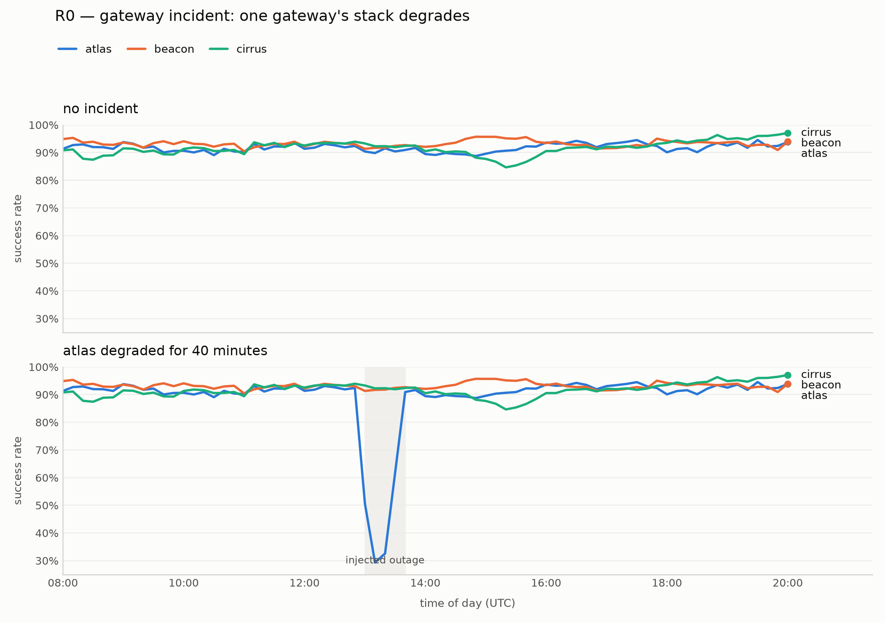
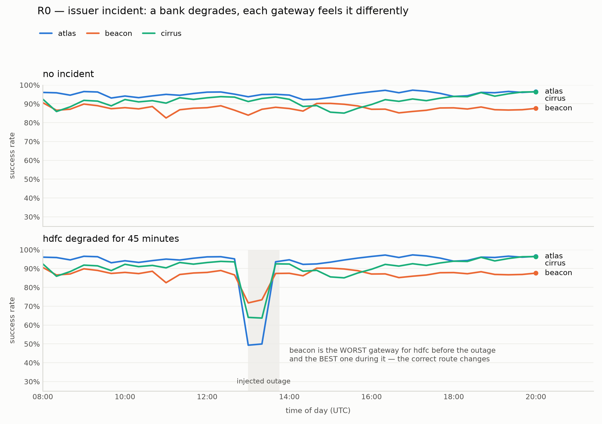
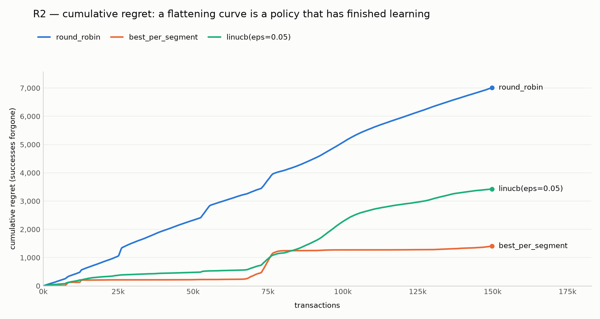
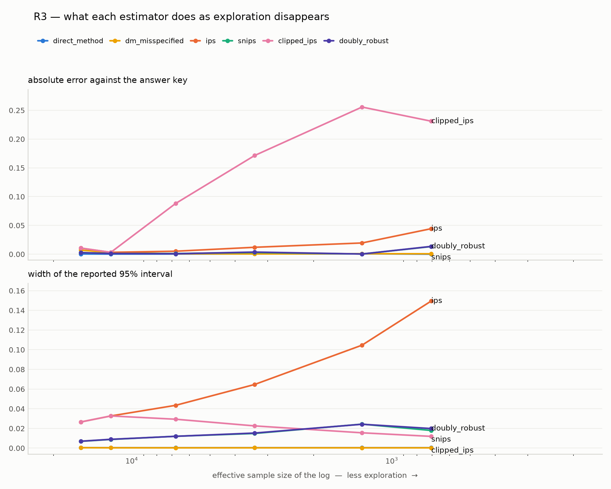

# PayRoute

A decision service that picks the payment gateway and retry strategy per
transaction to maximise expected net revenue under a latency constraint,
validated entirely offline via off-policy evaluation.

---

## ⚠️ This project runs against a simulator. Always.

**Nothing here is connected to a real payment gateway, a real bank, or real
payment data, and nothing here is ever deployed live.** Every transaction,
every gateway, every bank outage and every success or failure in this
repository is generated by the simulator in [`payroute/sim/`](payroute/sim/).
"atlas", "beacon" and "cirrus" are not real payment processors; they are three
rows in [`config/default_world.py`](config/default_world.py).

This is deliberate and it is the point. Because the world is synthetic we know
the *true* value of any routing policy, which is what makes it possible to
score an off-policy estimator against ground truth. That check is impossible
with real logged data — you would be comparing an estimate against another
estimate.

Any claim in this repository about a policy being "better" is a claim about
this simulator, and should be read that way.

---

## Why this is a contextual bandit and not a classifier

A payment aggregator routes each transaction through one of several gateways,
and the choice changes whether the transaction succeeds — bank endpoints
degrade unpredictably, and a large share of failures trace to bank-side
downtime rather than to the gateway itself.

The obvious framing — features in, "best gateway" out, train a classifier —
does not work, for a reason that is structural rather than a matter of model
choice:

- **The label does not exist.** Supervised learning needs the correct answer
  for each row. We observe the outcome of the one gateway we chose and never
  the others. Whether gateway A would have succeeded on a transaction we sent
  to B is not in the data and cannot be collected retroactively. That is the
  counterfactual problem.
- **Bandit feedback, not full feedback.** Labelling a photo "cat" tells you the
  answer *and* that every other class was wrong. A transaction outcome tells
  you about one action and is silent about the rest.
- **The log is shaped by the policy that produced it.** If the current rule
  sends all HDFC-UPI traffic to gateway A, the log contains no evidence about B
  for that segment — and a held-out split of that same log shares the blind
  spot, so standard validation cannot detect it.
- **It compounds.** A deployed classifier routes by its own beliefs, the next
  log concentrates further, and nothing exerts pressure to collect data about
  the roads not taken.

A contextual bandit addresses the last point directly: it spends a small amount
of revenue exploring, deliberately, as a data-acquisition strategy.

## The invariant the whole project rests on

**Every routing decision logs its propensity** — the probability the acting
policy assigned to the action it actually took, recorded at decision time,
alongside the context, the action and the reward.

This is not optional bookkeeping. Off-policy evaluation reweights the log by
`π_new(a|x) / π_log(a|x)` to estimate what a different policy would have
earned, and that denominator is the logged propensity. It cannot be
reconstructed later: recomputing it would require the exact model parameters,
the exact terminal-health state and the exact feature values at that
millisecond, and all three are long gone. A propensity is a measurement of a
moment; if you did not take it in that moment you cannot take it.

Propensity logging begins at R1 and is enforced by tests from R2 onward.

---

## Status

| Rung | What it builds | State |
|------|----------------|-------|
| **R0** | Gateway simulator: method/issuer mix, diurnal arrivals, background drift, gateway & issuer incidents | ✅ complete — 39 tests |
| **R1** | Round-robin, uniform-random, and three static-rule baselines | ✅ complete — 53 tests |
| **R2** | LinUCB contextual bandit, propensities logged | ✅ complete — 40 tests |
| **R3** | DM / IPS / SNIPS / DR / clipped-IPS vs ground truth | ✅ complete — 31 tests |
| R4 | Time-decayed per-terminal features; time-to-react | not started |
| R5 | Constrained selection under a p95 latency budget | not started |
| R6 | FastAPI + Redis + Kafka + Postgres service | not started |
| R7 | Tabular Q-learner for retries | not started |

## R0 results

Two incident types, both measured against a clean run driven by the **same
seed**, so the two panels of each figure see an identical transaction stream and
any difference between them is the incident and nothing else.

### Gateway incident — one gateway's stack degrades



| gateway | before | during | after |
|---------|--------|--------|-------|
| **atlas** (degraded) | 91.5% | **43.5%** | 91.9% |
| beacon | 92.7% | 91.8% | 93.2% |
| cirrus | 91.4% | 92.4% | 91.9% |

atlas drops and recovers; the other two are untouched — their clean and outage
columns are identical to the digit, which is the common-random-number design
working.

### Issuer incident — a bank degrades, and gateways feel it unequally



HDFC traffic only:

| gateway | configured hdfc sensitivity | before | during | drop |
|---------|------|--------|--------|------|
| atlas | 0.9 | 95.0% | 64.8% | −30.2 pts |
| cirrus | 0.6 | 91.5% | 73.7% | −17.7 pts |
| beacon | 0.3 | 87.2% | 77.7% | −9.5 pts |

This is the case that justifies the project. **beacon is the worst gateway for
HDFC before the outage and the best one during it.** The correct route changes
partway through the day and changes back — which is exactly what a static rule
table, written last quarter, cannot express.

Raw binned data: [`results/r0_gateway_outage.csv`](results/r0_gateway_outage.csv),
[`results/r0_issuer_outage.csv`](results/r0_issuer_outage.csv).

## R1 baselines — the numbers to beat

200,000 transactions, every policy on the identical transaction stream, 95%
intervals. The incidents scenario adds a sampled schedule of gateway and issuer
incidents over the same 34 hours.

| policy | success (clean) | success (incidents) | net revenue / 1k txn (incidents) |
|---|---|---|---|
| round_robin | 92.05% | 90.20% | 1,843,400 |
| uniform_random | 92.09% | 90.23% | 1,841,087 |
| always_cheapest | 91.07% | **89.07%** | **2,110,635** |
| historically_best | 92.80% | 91.26% | **1,542,134** |
| best_per_segment | **95.79%** | **93.81%** | 1,775,812 |

Paired against round_robin under incidents — same transactions, so the interval
on the difference is far tighter than on either mean:

| policy | success delta | net revenue delta / 1k |
|---|---|---|
| always_cheapest | −1.13% [−1.22, −1.04] | **+267,235** [+261,442, +273,028] |
| historically_best | +1.06% [+0.96, +1.15] | −301,266 [−307,216, −295,315] |
| best_per_segment | **+3.61%** [+3.52, +3.70] | −67,588 [−72,868, −62,307] |

**The highest-success policy is not the highest-revenue policy, and the ranking
inverts completely.** `best_per_segment` beats round-robin by 3.6 points of
success and still *loses* 67,588 paise per 1,000 transactions, because it routes
toward reliable gateways that charge more. `always_cheapest` has the worst
success rate of any baseline and earns the most. Optimising success rate alone
is not a proxy for optimising revenue here — it is actively opposed to it, which
is the argument R5 exists to make.

Raw table: [`results/r1_baselines.csv`](results/r1_baselines.csv).

### None of these baselines react

Share of traffic routed into a gateway while it is degraded:

| policy | share to atlas |
|---|---|
| round_robin | 33.3% |
| uniform_random | 33.3% |
| always_cheapest | 41.9% |
| historically_best | 0.0% |
| best_per_segment | 41.4% |

Round-robin's share during an outage is within 0.3 points of its share before
one — it has no mechanism capable of noticing. `historically_best` shows 0%
only because it happens to have picked a different gateway permanently, not
because it avoided anything. That inability to react is the gap every later
rung is built to close.

## R2 — LinUCB

150,000 transactions with a sampled incident schedule, every policy on the
identical stream, paired against LinUCB (epsilon = 0.05):

| baseline | success delta | net revenue delta / 1k |
|---|---|---|
| round_robin | +2.46% [+2.35, +2.56] | +74,177 |
| uniform_random | +2.35% [+2.25, +2.45] | +76,266 |
| always_cheapest | +3.80% [+3.69, +3.91] | −187,324 |
| historically_best | +0.92% [+0.81, +1.03] | +368,876 |
| best_per_segment | **−1.35%** [−1.43, −1.28] | +139,483 |



Round-robin's regret is close to linear — it never learns. LinUCB's flattens.
But look at transaction 75,000: an incident hits, `best_per_segment` absorbs it
and returns to flat, while **LinUCB's regret accelerates and is still climbing
at 150k**.

That is the honest headline of this rung: *LinUCB loses to a frozen lookup
table under incidents.* The cause is that `A` and `b` are unweighted sums over
all history, so after 75,000 observations a 40-minute outage is a vanishing
fraction of the evidence. The policy has no way to say "recent data matters
more" — which is precisely what R4 is for.

### The epsilon sweep — and a result that reverses the obvious story

| epsilon | success | net revenue / 1k | tail regret / txn | min propensity |
|---|---|---|---|---|
| 0.00 | 92.02% | 1,574,982 | **0.03680** | 1.0000 |
| 0.01 | 92.71% | 1,926,913 | 0.01755 | 0.0033 |
| 0.05 | 92.83% | **1,927,329** | 0.01798 | 0.0167 |
| 0.10 | 92.48% | 1,911,998 | 0.01841 | 0.0333 |
| 0.30 | 92.01% | 1,904,288 | 0.02080 | 0.1000 |

On a **stationary** world, epsilon = 0 wins outright: tail regret 0.00050
against 0.00298 at epsilon = 0.05. Exploration is a pure tax, paid to obtain a
loggable propensity.

Under **incidents** the ranking inverts. A deterministic LinUCB converges, its
confidence widths collapse, it stops sampling arms it believes are worse — and
so it cannot notice when the arm it settled on degrades. It ends up with double
the tail regret of every stochastic setting and 18% less revenue.

**So exploration buys two different things, and only one of them is a cost.**
It buys a propensity you can evaluate against, and it buys robustness to a
world that moves. R3 prices the first. R4 addresses the second properly.

The `min propensity` column is exactly `epsilon / K`, and it is the x-axis of
R3's headline chart: as it shrinks, importance weights grow and the estimators
degrade.

Raw data: [`results/r2_epsilon_sweep.csv`](results/r2_epsilon_sweep.csv),
[`results/r2_regret.csv`](results/r2_regret.csv).

## R3 — off-policy evaluation

60,000 transactions logged under LinUCB at a range of exploration rates,
evaluating a fixed `best_per_segment` target whose **true value is 0.9482** —
known exactly, because the world is synthetic.



| logging ε | ESS | DM | IPS | SNIPS | DR | clipped IPS |
|---|---|---|---|---|---|---|
| 0.30 | 15,686 | +0.0000 | +0.0105 | +0.0027 | +0.0027 | +0.0105 |
| 0.10 | 6,778 | +0.0003 | −0.0051 | −0.0011 | −0.0008 | −0.0881 |
| 0.05 | 3,370 | −0.0005 | +0.0120 | +0.0029 | +0.0036 | −0.1714 |
| 0.02 | 1,302 | −0.0007 | −0.0195 | +0.0003 | +0.0003 | **−0.2556** |
| 0.01 | 705 | −0.0000 | **+0.0443** | +0.0132 | +0.0135 | −0.2310 |
| 0.00 | — | −0.0011 | **refused** | **refused** | **refused** | **refused** |

IPS degrades exactly as the theory says: its interval widens from 0.027 to
0.150 as effective sample size collapses from 15,686 to 705, and its error
reaches +0.044. SNIPS and DR stay within ±0.014 throughout — the importance
weight multiplies a residual rather than a reward, so a weight of 300 multiplies
something near zero.

At ε = 0 the three propensity-based estimators **refuse**: *no overlap on 16,356
of 60,000 records*. That is not high variance that more data would fix. The log
contains no information about the actions the target would have taken
differently, so the value is not identified and any number returned would be
invented.

---

## When this OPE result should NOT be trusted

Quantified, because "be careful" is not a threshold.

**1. No overlap — the estimate does not exist.** If the target policy puts
probability on an action the logging policy could not have taken, the estimators
raise `NoOverlapError` rather than returning a number. Our ε = 0 log triggers
this on 27% of its records.

**2. Effective sample size below 1,000 — treat the interval as a floor.** Below
100 the result is reported as `untrustworthy`. ESS is
`(Σw)² / Σw²`: at ε = 0.01 our 60,000-row log carries **705 transactions' worth
of evidence**. The row count is not the sample size.

**3. A diagnostic that improves while the estimate degrades.** `clipped_ips` is
the cautionary tale, and we built it by accident before catching it. Its reported
interval *narrows* from 0.027 to 0.012 as its error grows from +0.01 to −0.26.
Clipping makes the weights uniform, so every variance-based diagnostic looks
healthier the more information is thrown away. At ε = 0.02, clipping just **0.2%
of records removed 27% of the estimate's value** — which is why the verdict now
escalates on clipped *weight mass*, not on the reassuring record count. See
[`docs/bugs.md`](docs/bugs.md).

**4. A narrow interval from the Direct Method means nothing.** DM never reads a
propensity, so its interval reflects only the spread of its own predictions. It
returns 0.9471 ± 0.0002 on the ε = 0 log — confident, precise, and derived from
data that cannot contradict it.

**5. The honest caveat about our own result.** In this simulator, success
probability is `base[method] + adjust[issuer]` — *exactly linear* in the features
the reward model uses. DM is therefore perfectly specified and has no bias to
exhibit, which is why it tops the table. We tried to remove that advantage with a
variant blinded to the issuer; it barely moved (+0.0007), because the model is
fitted on a log whose action distribution already correlates with the target's,
so its errors cancel. **We did not reproduce DM's known failure mode, and we
decline to manufacture one.** Read the DM column as a property of this world, not
as evidence that the Direct Method is safe.

Raw data: [`results/r3_ope.csv`](results/r3_ope.csv).

---

## Running it

```bash
python3 -m venv .venv
./.venv/bin/pip install -e . pytest matplotlib

./.venv/bin/python -m pytest -q                        # 163 tests
./.venv/bin/python experiments/r0_simulator_profile.py # simulator charts
./.venv/bin/python experiments/r1_baselines.py         # baseline table
./.venv/bin/python experiments/r2_linucb.py            # LinUCB + regret curve
./.venv/bin/python experiments/r3_ope.py               # estimator comparison
```

## Layout

```
payroute/
├── sim/          R0: the simulator — the measuring instrument for everything else
├── features/     context construction; R4's time-decayed terminal health
├── policies/     R1 baselines, R2 LinUCB, R5 constrained selection
├── ope/          R3: DM, IPS, SNIPS, DR + diagnostics (ESS, confidence intervals)
├── retry/        R7: tabular Q-learner
├── decisionlog/  the decision record — context, action, propensity, reward
└── service/      R6: FastAPI, Redis, Kafka, Postgres
config/           the simulator world; one definition, shared by tests and experiments
experiments/      scripts that produce numbers into results/
tests/            fast, deterministic, CI-runnable
docs/             decisions.md and bugs.md, maintained as we go
```

## Documentation

- [`docs/decisions.md`](docs/decisions.md) — every design decision, what was
  rejected, and why. The simulator's assumptions live here; they are the thing
  a skeptical reader should attack first.
- [`docs/bugs.md`](docs/bugs.md) — every bug, written down *before* being fixed,
  with the competing hypotheses and the test that separated them.
- [`CLAUDE.md`](CLAUDE.md) — the working rules for this project.

## Still to be written

- The measurement table across all rungs against the R1 baselines.
- The OPE estimator comparison: error against ground truth, and variance as the
  logging policy becomes more deterministic.
- ~~"When this OPE result should NOT be trusted"~~ — written, above.
